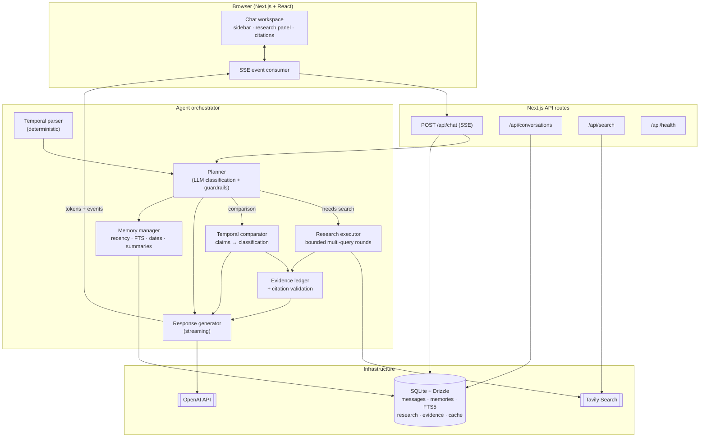

# Memento

**Your conversations have a history. The internet keeps changing. Memento connects both.**

Memento is a persistent conversational research agent. It remembers what you discussed across sessions, retrieves past conversations by date or topic, researches current information through web search, and — its signature capability — **compares what you knew then against what is true now**, claim by claim, with citations.

- Ask *"What did we shortlist on Monday?"* → answered from memory, no web search.
- Ask *"Has anything changed since then?"* → the earlier claims are extracted, current evidence is researched, and each claim is classified (unchanged / price increased / feature removed / inconclusive…) with supporting sources.
- Ask about anything else → direct, evidence-cited answers with honest uncertainty.

---

## Feature highlights

| Capability | How it works |
|---|---|
| **Persistent cross-session memory** | SQLite + Drizzle ORM; conversations, messages, rolling summaries and extracted memories survive restarts |
| **Historical conversation retrieval** | Hybrid: date-window queries (deterministic temporal parser), SQLite FTS5 full-text search, summary similarity, importance ranking |
| **Temporal reasoning** | "Last Tuesday", "since November 3", "three months ago" resolve to exact UTC ranges in the configured timezone (default Asia/Kolkata) — never LLM-guessed |
| **Then-vs-now comparison** | Claim extraction → current evidence → per-claim classification with mandatory citations; unsupported changes are downgraded to `INCONCLUSIVE` |
| **Intelligent web search** | One external tool (`web_search`) behind a provider abstraction (Tavily by default); entity-scoped queries, bounded concurrency, TTL cache, retries with backoff, graceful degradation |
| **Evidence & citations** | Numbered evidence ledger; every `[n]` in an answer is validated against the ledger — fabricated citations are structurally stripped |
| **Multi-entity research** | One query per entity (five CRMs → five queries), dedup, ranking, and a structured then-vs-now table |
| **Honest uncertainty** | Missing history is reported, not invented; missing evidence is "could not verify", never "unchanged"; conflicting sources are flagged with both cited |
| **Live research activity** | The UI's research panel renders only real backend SSE events — stages, queries, result counts, sources |
| **Bounded orchestration** | Max queries/turn, max iterations, per-query result caps, research wall-clock budget, token budget — all configurable via env |

## Technology stack

- **Frontend:** Next.js 16 (App Router), React 19, TypeScript, Tailwind CSS 4, shadcn/ui components, Lucide icons, responsive + dark mode
- **Backend:** Node.js, Next.js API routes, Server-Sent Events streaming, Zod validation, structured JSON logging, in-memory rate limiting
- **AI:** OpenAI API (model configurable), structured JSON outputs with schema validation + retry, streaming responses
- **Search:** Tavily Search API behind a `SearchProvider` interface
- **Database:** SQLite (better-sqlite3) + Drizzle ORM, FTS5 full-text search, runtime schema initialization (zero migration steps)
- **Testing:** Vitest — 76 tests (unit + integration), deterministic fake LLM/search providers, plus a 10-scenario evaluation suite (`npm run eval`)

## Architecture



**Source layout** (business logic lives in `src/server`, never inside UI components):

```
src/
  app/                    # Next.js routes (page + /api/chat, /api/conversations, /api/search, /api/health)
  components/             # UI: chat, sidebar, research, citations, settings, shadcn/ui primitives
  lib/client/             # API client, SSE chat state machine, formatting
  server/
    agent/                # orchestrator, planner, executor, response generator, prompts, tool registry
    memory/               # memory manager, conversation retriever, ranking, extractor, summarizer
    search/               # provider interface, Tavily, query planner, executor, normalizer
    research/             # source ranker, evidence ledger, claim verifier, temporal comparator
    database/             # Drizzle schema, runtime init, repositories (DI)
    llm/                  # LLM client interface, OpenAI implementation, tracked client
    evaluation/           # turn metrics
  shared/                 # isomorphic types, Zod schemas, temporal parser, utilities
  tests/                  # unit + integration suites and fixtures
  scripts/                # evaluation runner (npm run eval)
```

## Getting started

### Prerequisites

- Node.js ≥ 20
- npm
- An **OpenAI API key** (required for chat)
- A **Tavily API key** (required for web research; without it Memento still chats and remembers, but cannot verify current information)

### Install & run

```bash
npm install
cp .env.example .env      # then add your keys
npm run dev               # http://localhost:3000
```

The SQLite database (`data/memento.db`) is created and migrated automatically on first run — no setup, no Docker.

### Environment configuration

| Variable | Required | Default | Purpose |
|---|---|---|---|
| `OPENAI_API_KEY` | yes | — | Model access (chat, planning, comparison) |
| `OPENAI_MODEL` | no | `gpt-4o-mini` | Any chat-completions model |
| `OPENAI_BASE_URL` | no | `https://api.openai.com/v1` | Compatible gateways |
| `TAVILY_API_KEY` | yes* | — | Web search (*required only for research) |
| `DATABASE_URL` | no | `data/memento.db` | SQLite file (`file:` prefix optional) |
| `APP_TIMEZONE` | no | `Asia/Kolkata` | IANA timezone for temporal resolution |
| `MAX_SEARCH_QUERIES` | no | `6` | Query budget per turn |
| `MAX_SEARCH_RESULTS` | no | `5` | Results per query |
| `MAX_AGENT_ITERATIONS` | no | `3` | Orchestration round cap |
| `MAX_RESEARCH_TIME_MS` | no | `45000` | Research wall-clock budget |
| `MAX_TOTAL_TOKENS` | no | `60000` | Per-turn token budget |
| `SEARCH_TIMEOUT_MS` | no | `12000` | Provider timeout |
| `SEARCH_CACHE_TTL` | no | `900` | Cache TTL in seconds |
| `SEARCH_CONCURRENCY` | no | `3` | Parallel queries |
| `RATE_LIMIT_PER_MINUTE` | no | `30` | Chat requests per minute |
| `LOG_LEVEL` | no | `info` | `debug` · `info` · `warn` · `error` |

## Testing & evaluation

```bash
npm run typecheck   # strict TypeScript, zero errors
npm run lint        # ESLint (next/core-web-vitals + TS)
npm test            # 76 unit + integration tests (deterministic fakes, no keys needed)
npm run eval        # 10-scenario evaluation suite → evaluation/EVALUATION.md
npm run build       # production build
```

The evaluation suite measures historical-retrieval accuracy, unnecessary-search rate, citation validity, comparison accuracy, tool-call counts and orchestration latency across the ten challenge scenarios. See [`evaluation/EVALUATION.md`](evaluation/EVALUATION.md) for the latest measured results.

## Example conversations

**Memory (no search):**
> **You:** We shortlisted five CRM tools for a 20-person sales team on Monday.
> **You (Tuesday):** What did we shortlist on Monday?
> **Memento:** On Monday you shortlisted Salesforce, HubSpot, Zoho CRM, Pipedrive and Freshsales for your 20-person sales team — no web search needed, that's from our conversation.

**Temporal comparison:**
> **You:** Has any of them changed pricing since Monday?
> **Memento:** *(research panel shows 5 entity-scoped searches → sources → comparison)* I checked all five against Monday's discussion. Zoho CRM's Professional plan is still $23/user/mo [2]… Pipedrive appears to have adjusted Professional pricing to $49/user/mo [4] — up from $49.90, though I'd treat the old figure's precision with caution. Full then-vs-now table below.

**Honesty under failure:**
> **You:** Is that still correct? *(with the search provider down)*
> **Memento:** I couldn't re-verify that right now — web search is unavailable. Based on our last discussion (Nov 3), Neon Pro was $19/month, but please treat that as unverified.

## Known limitations

- **Single user.** The schema has a users table and per-user scoping, but auth isn't wired; a local default user is assumed.
- **LLM judgment is mocked in tests.** The suite validates orchestration deterministically; live-model quality depends on the configured model.
- **Comparisons depend on claim extraction quality.** Vague historical statements ("it was cheap") extract to vague claims and compare as `INCONCLUSIVE` — by design, rather than guessing.
- **Snippet-level evidence.** Verification trusts provider excerpts; full-page fetching and re-crawl verification are future work.
- **Embedding retrieval is interface-ready but not implemented** (hybrid recency + FTS + dates + importance covers the brief's scenarios without a paid embedding API).
- **Search requires Tavily.** The provider abstraction makes alternatives a single class, but only Tavily ships today.

## Security considerations

- API keys live only in `.env` (git-ignored) and are never sent to the browser; `/api/health` exposes configuration *state*, not secrets.
- All request bodies are Zod-validated; FTS queries are tokenized to alphanumerics (no operator injection).
- Structured server logs carry metadata (lengths, counts, durations, request ids) — not message content or keys.
- Rate limiting on chat/search endpoints; search results capped; orchestration budgets bound cost per turn.
- Deleting a conversation cascades to messages, FTS rows, summaries, research sessions, evidence and extracted memories in one transaction.

## License

[MIT](LICENSE)
